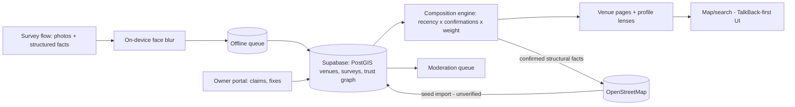

# Doorway — the map that answers "can I get in?"

Google Maps will tell you a café exists, its rating, its opening hours, and what its flat white costs. It cannot tell you the one thing that decides whether Tara's day works: is there a step at the door? For millions of people — wheelchair users, ambulatory-disabled people, parents with prams, autistic people budgeting sensory load, anyone recovering from surgery — the city is a minefield of unknowable thresholds, and every outing begins with detective work: squinting at Street View, phoning ahead to staff who say "oh yes, accessible" about a venue with a bathroom up six stairs. Doorway is the crowdsourced atlas of the details that decide the day: step-free entrances, door widths, grab bars, noise levels, lighting, staff patience. Filter the city by *your* needs, trust what you see because someone like you verified it, and — for once — just go.

## 1. Overview
- **Elevator pitch:** A crowdsourced accessibility atlas: structured 90-second venue surveys with photo evidence of entrances and bathrooms, personal needs-profiles that re-lens the same data for different disabilities, a verification/freshness model that keeps information trustworthy, venue-owner tooling that turns reports into fixes, and an open-data commitment that makes the commons durable.
- **Category:** Maps & Navigation / Social good — accessibility.
- **Tagline:** *The map that answers "can I get in?"*
- **Play Store positioning:** "Filter the city by your needs — step-free, quiet, well-lit, verified by people who checked."

## 2. Problem & Why Now
The information exists nowhere because it profits no one: venues overstate ("we're accessible!" — one step, narrow bathroom), platforms understate (Google's wheelchair-accessible flag is binary, sparse, unverifiable, and famously wrong), and the disability community compensates with private intel networks — Facebook groups, WhatsApp threads, the friend who went first. That informal network is proof of demand and a failure of infrastructure: 1.3 billion people worldwide live with significant disability (WHO), their households control trillions in spending, and ~15–25% of any city's population benefits directly from access data on any given day (add prams, injuries, aging knees). Existing attempts prove pieces: Wheelmap (OSM-based, 1M+ venues tagged) proved crowdsourcing works but stalled at a binary traffic-light for wheelchairs only; AccessNow and AXS Map proved apps can exist but starved on data density and single-lens design. The unclaimed synthesis: **structured multi-dimensional surveys + needs-profile lenses + verification/freshness mechanics + a business model** (venue-side) that funds the commons without corrupting it. Why now: disability advocacy has genuine policy tailwind (accessibility lawsuits reshaping compliance budgets; the EU Accessibility Act in force), the sensory-accessibility conversation (autism, ADHD, migraine) finally entered mainstream venue awareness, and camera-first structured surveys make data collection fast enough to scale on goodwill.

## 3. Target Audience & Personas
- **Tara, 31, wheelchair user, product designer, Toronto.** Plans every outing with 20 minutes of recon; has been stranded at "accessible" venues a dozen times. Doorway's entrance photos alone ("I trust a photo over any checkbox") change her weekly radius. Becomes a top surveyor — 200 venues in a year — because every survey is one less ambush for the next person.
- **Jonas, 38, autistic software engineer, Berlin.** His constraint is sensory: noise, lighting, crowding. No map on earth serves him today. Doorway's sensory lens (noise estimates, lighting notes, quiet corners flagged) makes restaurants navigable; his profile filters the same database Tara built, differently — the multi-lens architecture proving itself.
- **Priya, 52, café owner, Manchester.** Gets a Doorway report: her step has a threshold fix costing £80; her bathroom rail is 4cm too low. Claims her listing, posts the fixes, earns the "listened & fixed" badge that Doorway users actively seek out. She is the revenue and — handled right — a genuine ally, not a target.

## 4. Core Concept Deep-Dive
**Structured surveys beat reviews.** Free-text reviews rot into vibes; Doorway's atom is the **90-second structured survey**: a guided flow of concrete, observable questions with photo prompts at the two decisive locations — *the entrance* (photo + step count + step height if any + door width estimate via reference-card AR assist + door weight/automatic?) and *the bathroom* (photo + grab bars + turning space + sink height). Then quick taps: interior circulation (tight/okay/generous), seating (fixed/movable, table heights), noise level at time of visit (calibrated phone estimate + subjective tap), lighting (harsh/mixed/soft), staff response (a carefully worded "how did staff respond to access needs?" — optional, structured choices, no rant field). Every answer is a fact a stranger can act on; nothing is a star rating. Surveys are additive — three partial surveys from different visitors compose into one confident listing.

**Needs profiles re-lens one database.** At onboarding (optional, skippable, never demanded): "what decides your day?" — build a profile from need modules: *wheeled mobility* (thresholds: max step height, min door width, bathroom requirements), *ambulatory* (distance, seating availability, handrails — the largest and most ignored mobility cohort), *sensory* (noise/light/crowd weights), *low-vision* (lighting, contrast, menu formats), *hearing* (loop systems, quiet zones for lip-reading). The same venue renders differently per profile: Tara sees "✓ step-free, ✓ bathroom verified 3 months ago, ⚠ heavy door"; Jonas sees "quiet before noon, harsh pendant lighting, booths available." One commons, many doors into it — this is the architectural thesis and the reason Doorway can serve 25% of the city rather than 2%.

**Trust mechanics are the product's spine.** Every data point carries: *who-shaped* provenance (surveyed by a profile-matching user? venue-claimed? imported?), *confirmation count* (independent surveys agreeing), and *freshness* (data decays visibly — a 2-year-old bathroom photo shows its age and the app asks visitors to re-verify; renovations are the silent data-killer and decay is the honest answer). **Trusted Surveyor** status (10+ surveys, 90%+ confirmation agreement) weights contributions and unlocks the advanced survey (measurements, loop-system checks). Disagreements resolve by recency + photo evidence + surveyor weight — mechanical, legible, appealable. The community's informal networks earned trust through skin in the game; Doorway's mechanics encode exactly that.

**Venue partnership without capture.** Owners claim listings (verified), see their reports, and respond in one constrained way: *fix and prove it* (post the fix with a photo → flagged for community re-verification → the **"listened & fixed"** badge only after independent confirmation). Owners can never edit community data, never pay for better scores, never suppress surveys — the wall between revenue and truth is absolute and *published*. What they can pay for: analytics (how many profile-filtered searches excluded them and why — "you appeared in 400 searches and were filtered from 220 for: no step-free entrance"), fix-guidance content (costed, sourced, jurisdiction-aware), and promotion *only* of verified-accessible attributes to matching profiles. The pitch to Priya is honest: this is footfall you're currently invisible to.

**Open data as constitution.** Community-contributed structural data (steps, widths, features — not photos/users) syncs to OpenStreetMap under compatible licensing and exports freely; Doorway's moat is the survey UX, the lenses, the trust graph, and the venue relationships — never data hostage-taking. This is both ethics and strategy: the commons outliving the company is a promise the disability community has learned to demand (they've watched access projects die and take their data with them), and it's the single strongest trust signal available at launch.

## 5. Complete Feature Set
**MVP (v1.0):**
- Map + search with profile-lens filtering (step-free / bathroom / quiet / well-lit as instant chips even without a full profile); venue pages with photo-first entrance/bathroom evidence, structured facts, freshness indicators.
- The 90-second survey flow with AR width-assist and noise sampling; partial-survey composition; photo capture with privacy guard (automatic face blurring — bystanders and surveyors both).
- Needs profiles (five modules, mixable), skippable with chip-filters for casual users.
- Trust layer v1: confirmations, freshness decay, Trusted Surveyor, disagreement resolution, report/appeal.
- Wheelmap/OSM import as seed data (clearly marked as unverified-imported until confirmed).
- City guides seeded for launch cities ("50 verified step-free brunches in Toronto" — editorial from the data).
**v1.x fast-follows:**
- Venue claiming + owner response flow + "listened & fixed"; fix-guidance library.
- Routes layer: step-free walking directions between verified points (kerb cuts crowdsourced — the pedestrian graph the transit apps lack); saved lists ("date spots that work", shareable — the community's private intel networks, given a home).
- Sensory time-profiles (venues quiet at 10am, roaring at 8pm — time-sliced noise data).
**v2.0+:**
- Owner analytics dashboard + subscriptions; API for partners (booking platforms, city tourism sites — accessibility data where decisions happen).
- Event/venue temporary surveys (concerts, markets, polling stations — election-day access mapping as recurring civic moment).
- Indoor wayfinding pilots for large venues (malls, hospitals — B2B-funded).

## 6. Screen-by-Screen UX Walkthrough
Navigation: bottom bar — **Map**, **Search**, **Contribute**, **Saved**, **You**. The whole app meets WCAG 2.2 AA as a floor with TalkBack-first development (an accessibility app that fails a screen reader is a self-refuting object; the portfolio's only app where accessibility is not a feature but the *subject*).
- **Map:** profile-lens active by default (toggleable to "everyone view"); venues as confidence-coded pins (solid = verified for your profile, hollow = partial data, faded = imported-unverified); tap → card with the *decisive facts first* (your profile's dealbreakers answered above the fold).
- **Venue page:** entrance photo hero (the trust object), fact grid per category with provenance chips ("3 surveys · last verified Jan"), bathroom section, sensory section, staff notes, "verify this" CTA when stale, owner-response block (badged if fixed).
- **Survey flow:** launched from a venue or "survey where I am"; the guided 90-second path with progress dots, camera prompts with framing guides ("stand back far enough to show the whole doorway"), skip-anything design (partial data welcomed explicitly).
- **Contribute:** nearby venues needing surveys/re-verification as a gentle queue ("3 stale listings on your street"), your surveyor stats, Trusted progress.
- **Saved:** lists, shareable; offline caching of saved venues (connectivity fails exactly when you're out).
- **You:** profile modules editor, contribution history, settings (including "everyone view" default for allies/carers using the app on someone's behalf — a real and designed-for cohort).
**Key flow — the Friday decision:** Tara, 6pm, three restaurant candidates in Saved → profile lens answers instantly: one solid pin (verified step-free, bathroom confirmed 2 months ago, heavy door noted — she can handle heavy with company), one hollow (no bathroom data — risk), one filtered out (single step, no ramp) → books the first, arrives, it matches the photos → taps "still accurate" on exit (2-second re-verification — the lightest contribution rung, and the freshness engine's fuel).
**Key flow — the survey habit:** Jonas finishes lunch somewhere new → Doorway's gentle geofenced prompt (opt-in, max 1/day): "survey this place? ~90 seconds" → he does the sensory + entrance modules (his lenses) → composition credits his partial against a wheelchair user's earlier entrance survey → the venue page turns solid for two profiles at once. Nobody surveyed everything; the commons composed it.

## 7. Design Language
Civic clarity with warmth — closer to excellent wayfinding than to app-store gloss: high-contrast palette (deep ink on warm white, with a confident teal for verified and amber for stale — all states redundantly encoded in icon + text, never color alone), generous type scaled to system settings without breakage (test at 200%), touch targets 48dp minimum everywhere. Type: a highly legible humanist sans (Atkinson Hyperlegible — the Sway choice, here as subject-matter statement) at body sizes larger than fashion dictates. Photography discipline: entrance photos framed consistently by the capture guides — the venue pages end up looking almost architectural, which builds trust (evidence, not ambience). Motion: minimal, reduced-motion-respecting by default. Tone: factual, warm, zero inspiration-porn ("verified step-free" not "wheelchair-friendly!"; the community's style guides — written *with* disabled writers on the team — govern every string; banned-words list includes "special needs," "differently-abled," and all euphemism).

## 8. Technical Architecture
Opinionated stack: **Kotlin + Jetpack Compose** with TalkBack-first component library (every custom component ships with semantics tests in CI — accessibility regressions block merges; this is the one codebase where that's non-negotiable), maps via **MapLibre + OSM**. Backend: **Supabase/Postgres + PostGIS** — venues, surveys, and the composition engine (facts materialize from survey sets via deterministic rules: recency × confirmation × surveyor weight); photo pipeline with on-device face blurring (MediaPipe) *before* upload (privacy at the edge, provable). OSM sync: two-way — import seeds in (flagged unverified), community-confirmed structural facts export out via the OSM changeset API under ODbL-compatible terms (legal review on licensing boundaries done early; photos and profiles never leave). Noise sampling: on-device dB estimation calibrated per device class, always paired with the subjective tap (hardware variance makes the pairing honest). Offline: saved venues + map tiles cached; surveys queue offline and upload later (survey-worthy places often have no signal). Moderation: photo moderation API + human queue + community flags; the survey structure itself is the primary abuse limiter (structured facts are hard to weaponize; the staff-response field is choice-based partly for exactly this reason).

## 9. Data Model
- **Venue:** `id`, `osm_ref?`, `name`, `location`, `category`, `claimed_by?`, `composed_facts{}` (materialized), `confidence_by_profile{}`, `last_verified_at`.
- **Survey:** `id`, `venue_id`, `surveyor_id`, `modules_completed[]`, `facts[{key, value, photo_ref?, measured:bool}]`, `noise_sample{db_est, subjective}`, `at`, `composition_weight`.
- **Fact keys (the ontology — versioned, the real IP):** `entrance.steps_count`, `entrance.step_height_cm`, `entrance.door_width_est`, `entrance.door_auto`, `bathroom.grab_bars`, `bathroom.turning_space`, `interior.circulation`, `sensory.noise_typical`, `sensory.lighting`, `staff.response`, … (~60 keys at launch, governed by a public changelog with community input).
- **Profile:** `user_id`, `modules[{type, params{max_step_cm?, min_door_cm?, noise_weight?}}]` — stored locally by default, synced only opt-in (health-adjacent data; minimize by architecture).
- **SurveyorStanding:** `user_id`, `surveys_n`, `agreement_rate`, `trusted:bool`, `advanced_unlocked`.
- **OwnerAction:** `venue_id`, `owner_id`, `type{claim|fix_posted|response}`, `evidence_ref`, `reverified:bool`.
- **List:** `id`, `owner_id`, `venue_ids[]`, `shared:bool`, `title`.

## 10. Monetization
The commons is free and unpolluted; venues and institutions pay. **Free forever, all users:** every map, lens, survey, list, and byte of community data — monetizing disabled users' access to access would be obscene and is structurally excluded. **Venue tiers:** claiming + responding + fix-badges free (the flywheel must spin); **Doorway for Venues — $19/month** (or local-tier equivalent): the filtered-search analytics, fix-guidance library with costed recommendations, verified-attribute promotion to matching profiles (never rank manipulation — presence in results is data-determined, full stop), multi-location dashboard for small chains. **Institutional:** city tourism boards, transit authorities, BIDs (business improvement districts), and event venues license API access + district reports ($2k–20k/year engagements — the EU Accessibility Act makes this a compliance-adjacent budget line, and district-level "access audits from live data" undercut consultancy prices with better data). **Grants:** like Patchwork, honestly grant-shaped (disability inclusion funding is substantial and this is exactly what funders want built); the reporting module doubles as grant deliverable. Explicitly excluded: ads, data sale, sponsored placement in results. Sustainability math: 2,000 venue subs + 15 institutional contracts ≈ $700k ARR — a mission-scale business, deliberately (the mittelstand pattern this portfolio keeps choosing on purpose).

## 11. Play Store Listing
- **Title (≤30):** `Doorway: Accessibility Map` (26)
- **Short description (≤80):** `Step-free? Quiet? Verified. The city, filtered by what your day needs.` (70)
- **Full description:** open with Tara's 20 minutes of recon; blocks: Photos Beat Checkboxes (survey evidence), Your Lens on the City (profiles: mobility, sensory, low-vision, hearing), Data You Can Trust (verification, freshness, provenance), Venues That Listen (fix badges — invite owners in the listing itself), A Commons That Outlives Us (open data pledge). Close with the survey invitation ("90 seconds at your next coffee makes someone's Friday work").
- **ASO keywords:** wheelchair accessible places, accessibility map, step free access, disabled access app, quiet restaurants autism, accessible bathrooms near me, wheelmap alternative, sensory friendly, pram accessible, mobility map.
- **Content rating:** Everyone. UGC declarations (surveys, photos, lists) with full report/block/appeal tooling.
- **Policy notes:** photos of public venue exteriors/interiors with automatic face-blurring documented; needs-profiles are sensitive-adjacent → local-by-default storage, opt-in sync, Data safety form treating profile data as health-adjacent with maximal caution; no ads SDKs; the open-data licensing (ODbL boundary between community facts and Doorway assets) legally reviewed and published.

## 12. Growth & Marketing Plan
The community *is* the distribution — the strategy is to deserve it and equip it. (1) Launch-city density (the Patchwork law): 3 cities, each seeded via **mapping parties** with disability organizations — 30 surveyors, one Saturday, 400 venues verified; the org co-brands the city guide, local press covers it (access + community + concrete artifact = reliable local news), and the app launches *useful*, not empty. (2) The informal networks: those Facebook groups and WhatsApp threads get white-glove courtship — their admins become founding Trusted Surveyors, their pinned intel becomes seeded lists with credit; Doorway's pitch is "your knowledge, structured, so it stops dying in the scroll." (3) Creator layer: disabled travel/food creators (a genuinely thriving YouTube/TikTok niche — wheelchair travel vlogs, autistic café reviews) get early access and surveyor tools; their content *is* venue pages with faces. (4) The fix-badge PR engine: every "listened & fixed" is a good-news story with a named small business — feed local media monthly; access wins are rare positive disability coverage and editors know it. (5) Election days, festival seasons, and EU-Act compliance deadlines as campaign moments. (6) Ally activation done right: "survey while you wait for your coffee" framing for non-disabled users — contribution without savior tone, guided by the style guide. Retention is mission-native: every re-verification prompt is a tiny act of solidarity with the next person, and the product says so, quietly, once.

## 13. Analytics & KPIs
North star: **profile-filtered searches that end in a confident answer** (solid-pin result rate for lensed searches; target ≥ 70% in launch cities by month 6 — the "can I get in?" question, actually answered). Key events: `search_lensed{profile_modules}`, `solid_pin_rate`, `venue_page_decisive_fact_view`, `survey_started/completed{seconds, modules}`, `still_accurate_tap`, `composition_event` (partials merging), `trusted_surveyor_reached`, `list_shared`, `owner_claimed/fix_posted/reverified`, `osm_export_batch`. Health thresholds: survey completion ≥ 80% of starts (the 90-second promise, measured); median survey 90–120s; re-verification response ≥ 25% of stale-prompts; surveyor Gini watched (a commons carried by 20 heroes is fragile — parties and prompts spread the load); fix-badge conversion ≥ 15% of owner-claimed venues with reports; zero tolerance metric: any verified-wrong "solid" report investigated within 48h (the Tara-stranded scenario is the product's cardinal failure — it gets incident-review process, not a dashboard line).

## 14. Risks & Mitigations
- **Data density death (the category's graveyard):** launch-city discipline, mapping parties, OSM seeding honestly labeled, partial-survey composition (lowering the contribution floor), and the still-accurate tap (2-second contributions). Success metric gates expansion: no city #4 until cities 1–3 hit solid-pin thresholds.
- **Wrong data strands someone:** freshness decay, photo evidence primacy, incident review, provenance always visible, and language discipline (Doorway reports evidence, never guarantees — counsel-reviewed, but the deeper mitigation is cultural: photos and dates let users calibrate trust themselves, which the community already expertly does).
- **Venue hostility/legal pressure:** structured facts + photos of observable features from public vantage are defensible (review per jurisdiction); the fix-first owner channel converts adversaries into badge-seekers; no free-text rant fields to litigate.
- **The savior-tone failure mode:** disabled leadership in the team and style-guide governance, community advisory board with real veto on language and features, mapping-party partners as co-owners of city launches. This risk is reputational and moral, and it is managed by *who builds it*, not by copy edits.
- **Google ships better access data:** the platform's incentive is checkbox-breadth, not verified depth or sensory lenses; Doorway's moat is trust mechanics + community + multi-lens ontology; and OSM export means even a platform win leaves the commons better — an acceptable defeat condition, stated internally without flinching.
- **Profile-data sensitivity:** local-by-default, opt-in sync, no third-party SDKs, and the architecture-as-policy pattern (this portfolio's spine) applied at its most serious.

## 15. Competitive Landscape
- **Wheelmap (Sozialhelden):** the honorable pioneer — OSM-native, million-plus venues, binary wheelchair traffic-light; no bathrooms detail, no photos-as-evidence structure, no sensory/other lenses, aging app. Ally posture: shared OSM substrate means Doorway's exports enrich Wheelmap too; compete on depth, cooperate on commons.
- **AccessNow / AXS Map / iAccess:** venture/nonprofit attempts proving demand and demonstrating the density trap; review-style data, single-lens, sparse outside home cities.
- **Google Maps accessibility attributes:** the sleeping giant — binary flags, owner-supplied, unverifiable, no evidence, no lenses, wrong often enough that the community distrusts it categorically; Doorway's verified-photo model is the direct answer, and "we show you the doorway" is the comparison that needs no elaboration.
- **AccessAble (UK):** professional-surveyor model — deep, accurate, expensive, slow, UK-bound; validates that structured depth is what users want; Doorway crowdsources 80% of that depth at 100× the coverage rate.
- **The Facebook groups (the true incumbent):** perfect trust, zero structure, knowledge dying in the scroll daily; Doorway is their memory — the courtship strategy above is the whole game.

## 16. Development Plan
Small team by necessity (dev + community lead from the disability community + part-time designer; the Keyfob rule — some products shouldn't be solo — applies for legitimacy reasons here), ~26 weeks to launch. W1–3: ontology v1 with advisory board (the fact-key schema is the constitution — draft it with the people it serves), venue/survey/composition data model. W4–7: survey flow with capture guides, face blurring, AR width-assist, offline queue; usability-tested with disabled testers from week 5 (paid, always). W8–10: map/search/lens engine, venue pages, provenance UI. W11–12: trust layer (confirmations, decay, Trusted Surveyor), OSM import pipeline. W13–14: TalkBack-first hardening pass with blind testers; WCAG audit (external). W15–17: lists, saved/offline, contribute queue, moderation ops. W18–20: city-1 mapping-party pilot (the real beta — one org, one Saturday, 300 venues; instrument everything); iterate survey friction from field data. W21–23: cities 2–3 seeding + parties; owner claiming MVP; OSM export legal + implementation. W24–25: store assets, style-guide-reviewed listing, launch guides. W26: launch. Venue subscriptions and analytics ship the following quarter (revenue follows density, never precedes it). **If behind:** cut AR width-assist (manual estimate), sensory time-profiles, and city 3 — never cut face blurring, the TalkBack pass, or mapping parties.

## 17. Moonshots
- **The kerb-cut graph:** full pedestrian-accessibility routing (step-free A-to-B including crossings, gradients, and construction closures) — the missing layer under every transit app; partner with transit agencies who are legally obligated to care and data-poor.
- **Standard-setter:** the fact-key ontology published as an open standard adopted by booking platforms (imagine OpenTable filtering by verified bathroom access) — the Keyfob/Patchwork open-protocol instinct at its most consequential.
- **Access audits as a workforce:** paid surveying programs employing disabled surveyors for institutional contracts — the commons' heroes becoming its professionals (dignity economics, the Patchwork kinship).
- **Global South adaptation:** ontologies and survey flows co-designed for radically different built environments (informal infrastructure, absent regulation) with local disability orgs — where the need is largest and every existing tool assumes a Western streetscape.
- **The threshold census:** an annual open report — "the state of the doorstep" — quantifying urban access from live data (median step heights, bathroom verification rates, fix velocity by city); advocacy ammunition nobody has ever had, published free, cited forever.
